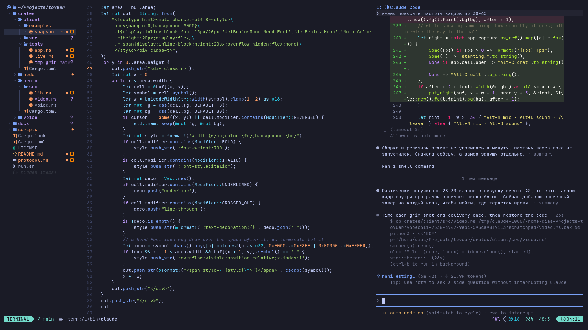
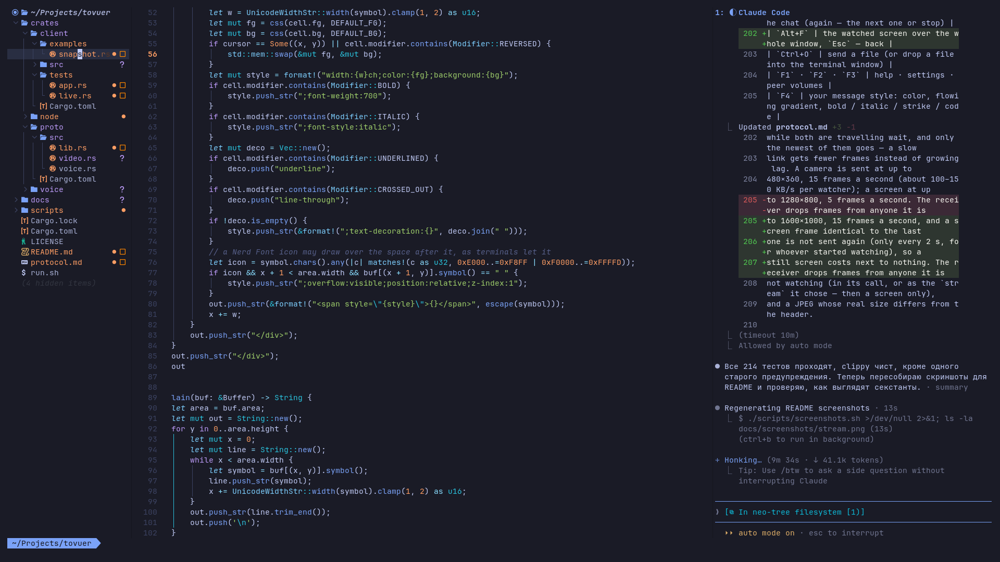

# lazyvim-agent

A Cursor-style AI agent panel for [LazyVim](https://www.lazyvim.org), plus the
git tools to review what the agent did.

**English** · [Русский](README.ru.md)


<sub>Claude Code in the right split: the file tree and code on the left, Claude's edit on the right.</sub>

This is not a new plugin. It is a ready, tested set of
[lazy.nvim](https://github.com/folke/lazy.nvim) specs that wires three
existing plugins together with keymaps that don't conflict:

- **[claudecode.nvim](https://github.com/coder/claudecode.nvim)**: Claude Code
  in a right split (40% wide). It connects to Neovim the same way the VS Code
  extension does: it knows the current file and selection, and shows its edits
  as native Neovim diffs that you accept or reject. You can edit the proposed
  change before accepting it.
- **[sidekick.nvim](https://github.com/folke/sidekick.nvim)**: any other agent
  CLI you have installed (Codex, OpenCode, Cursor Agent, Copilot CLI, Gemini,
  Aider, …) in the same kind of panel, with a prompt menu (explain, fix,
  review, write tests, fix diagnostics). Buffers reload when the agent changes
  files on disk.
- **[diffview.nvim](https://github.com/sindrets/diffview.nvim)**: every
  uncommitted change in one tab, so you can review an agent's work before you
  commit it. Plus file and repo history, an inline blame toggle and treesitter
  highlighting for commit messages and rebase lists.

It sits on top of what LazyVim already has for git: lazygit, gitsigns hunks
and the Snacks git pickers.


<sub>Claude knows what you are looking at: its input line shows the file selected in neo-tree as context.</sub>

## Requirements

- Neovim **0.11.2** or newer (needed by sidekick.nvim)
- LazyVim (the specs use Snacks and LazyVim's which-key groups)
- [Claude Code](https://docs.anthropic.com/en/docs/claude-code) (`claude`) for
  the main panel; any other agent CLI is optional
- `git`; [lazygit](https://github.com/jesseduffield/lazygit) for `<leader>gg`

No API keys are needed. Each agent CLI uses its own login or subscription.

## Install

Create `~/.config/nvim/lua/plugins/agent.lua`:

```lua
return {
  { "dszhlt/lazyvim-agent", import = "lazyvim-agent.plugins" },
}
```

Restart Neovim. lazy.nvim installs everything on the first start.

To take only one half, import a single file:

```lua
{ "dszhlt/lazyvim-agent", import = "lazyvim-agent.plugins.ai" },  -- agents only
{ "dszhlt/lazyvim-agent", import = "lazyvim-agent.plugins.git" }, -- git only
```

> **Note:** don't enable LazyVim's `ai.sidekick` extra at the same time: its
> `<leader>aa`, `<leader>as`, `<leader>ad` and `<leader>af` keys clash with the
> Claude keys here. LazyVim's `ai.claudecode` extra is fine; it uses the same keys.

## Usage

1. Open a project and press `<leader>ac` (or run `:ClaudeCode`). Claude opens
   on the right. In a new folder it first asks whether you trust it; it
   connects to Neovim after that.
2. Select code and press `<leader>as`. Focus jumps to Claude so you can type
   what to do with it.
3. When Claude wants to change a file, a diff opens: `<leader>aa` (or `:w`)
   accepts it, `<leader>ad` rejects it.
4. Press `<leader>gv` to review everything that changed, then commit from
   lazygit with `<leader>gg`.

`<C-h>` moves from the agent to your code, `<C-l>` moves back. To scroll or
copy in the agent window, leave terminal mode with `<C-\><C-n>`; `i` returns
to typing.

## Keymaps

### Claude Code

| Key | Action |
|---|---|
| `<leader>ac` | toggle Claude |
| `<leader>af` | focus Claude |
| `<leader>ar` | resume an earlier session |
| `<leader>aC` | continue the last session |
| `<leader>am` | pick a model |
| `<leader>aq` | close Claude |
| `<leader>ab` | add the current buffer to the context |
| `<leader>as` | send the selection (visual) / add the file (in a file explorer) |
| `<leader>aa` | accept the proposed diff |
| `<leader>ad` | reject the proposed diff |

### Other agents

| Key | Action |
|---|---|
| `<leader>ao` | pick an installed agent CLI or a running session |
| `<leader>aO` | show or hide the agent window |
| `<leader>ap` | prompt menu: explain, fix, review, tests, diagnostics |
| `<leader>av` | send the selection (visual) |
| `<leader>aF` | send the current file |

### Git

| Key | Action |
|---|---|
| `<leader>gv` | Diffview: review all uncommitted changes (toggle, `q` closes) |
| `<leader>gF` | Diffview: history of this file, or of the selected lines |
| `<leader>gV` | Diffview: history of the repo |
| `<leader>gt` | toggle inline blame |

LazyVim already provides `<leader>gg` lazygit, `<leader>gs` status,
`<leader>gd` diff, `<leader>gl` log, `]h` / `[h` hunks and
`<leader>ghs` / `<leader>ghr` / `<leader>ghp` to stage, reset or preview a hunk.

## Customize

Add a spec for the plugin you want to change. Your values always win over the
defaults here:

```lua
return {
  { "dszhlt/lazyvim-agent", import = "lazyvim-agent.plugins" },

  -- Claude on the left, 35% wide
  {
    "coder/claudecode.nvim",
    opts = { terminal = { split_side = "left", split_width_percentage = 0.35 } },
  },

  -- other agents in a floating window
  { "folke/sidekick.nvim", opts = { cli = { win = { layout = "float" } } } },
}
```

The upstream READMEs list every option:
[claudecode.nvim](https://github.com/coder/claudecode.nvim#advanced-configuration),
[sidekick.nvim](https://github.com/folke/sidekick.nvim#%EF%B8%8F-configuration),
[diffview.nvim](https://github.com/sindrets/diffview.nvim#configuration).

## Credits

All of the real work is done by
[coder/claudecode.nvim](https://github.com/coder/claudecode.nvim),
[folke/sidekick.nvim](https://github.com/folke/sidekick.nvim),
[sindrets/diffview.nvim](https://github.com/sindrets/diffview.nvim),
[LazyVim](https://github.com/LazyVim/LazyVim) and its git setup. This repo
only configures them to work together.

## License

[MIT](LICENSE)
