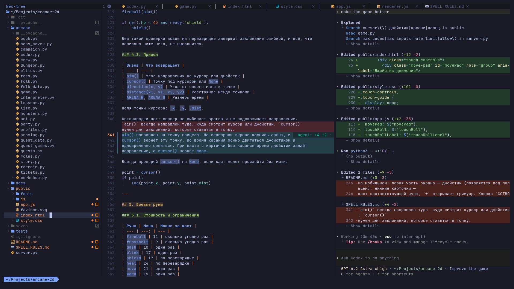
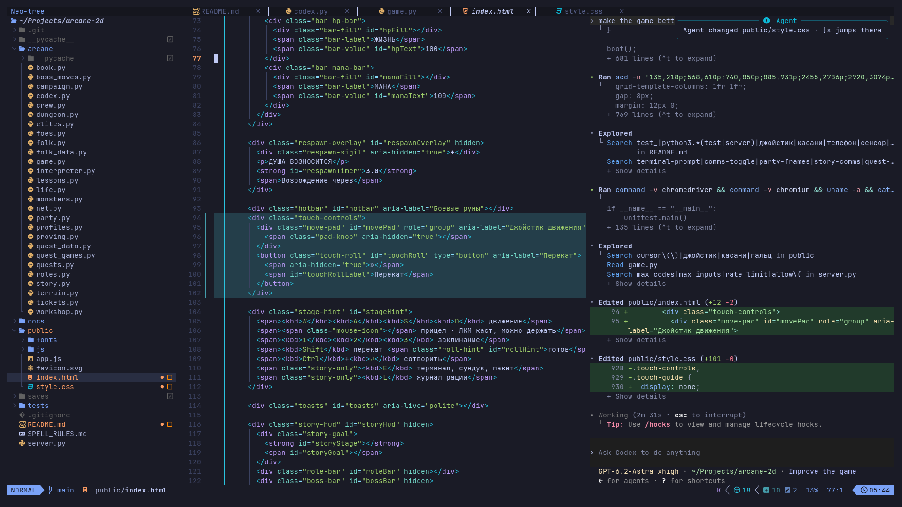
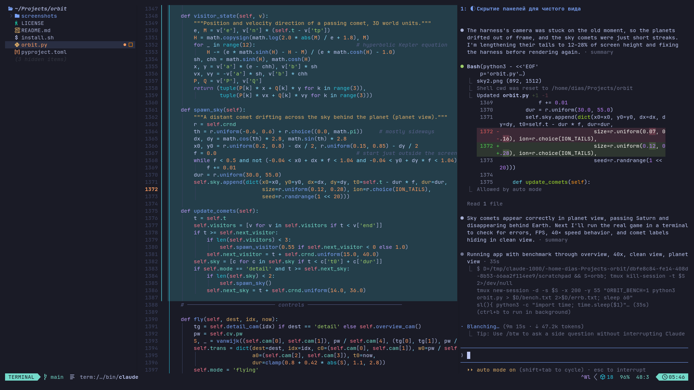

# lazyvim-agent

A Cursor-style AI agent panel for [LazyVim](https://www.lazyvim.org), plus the
git tools to review what the agent did.

**English** · [Русский](README.ru.md)


<sub>Codex rewrites a paragraph in the right panel, and the same edit shows up inline on the left: removed lines in red above the new ones, with the change size next to the cursor.</sub>

This is mostly not a new plugin. It is a ready, tested set of
[lazy.nvim](https://github.com/folke/lazy.nvim) specs that wires three
existing plugins together with keymaps that don't conflict, plus one small
module of its own:

- **[claudecode.nvim](https://github.com/coder/claudecode.nvim)**: Claude Code
  in a right split (40% wide). It connects to Neovim the same way the VS Code
  extension does: it knows the current file and selection. When Claude asks
  before an edit, the edit shows up inline in the file (removed lines red, new
  lines green) for you to accept or reject.
- **Live edits** (this repo's `lazyvim-agent.follow`): when an agent changes
  files without asking (Claude's auto mode, or any other agent), you watch it
  happen in the editor. The edited file opens on the left at the spot that
  changed, the changes stay marked inline, and you keep or undo each one, the
  way Cursor's Keep / Undo works.
- **[sidekick.nvim](https://github.com/folke/sidekick.nvim)**: any other agent
  CLI you have installed (Codex, OpenCode, Cursor Agent, Copilot CLI, Gemini,
  Aider, …) in the same kind of panel, with a prompt menu (explain, fix,
  review, write tests, fix diagnostics).
- **[diffview.nvim](https://github.com/sindrets/diffview.nvim)**: every
  uncommitted change in one tab, so you can review an agent's work before you
  commit it. Plus file and repo history, an inline blame toggle and treesitter
  highlighting for commit messages and rebase lists.

It sits on top of what LazyVim already has for git: lazygit, gitsigns hunks
and the Snacks git pickers.


<sub>Codex adds touch controls: the new block in index.html is highlighted in the editor. style.css changed while the cursor was in the editor, so it was not pulled in front of you; a notification says where to jump.</sub>

## Requirements

- Neovim **0.11.2** or newer (needed by sidekick.nvim)
- LazyVim (the specs use Snacks and LazyVim's which-key groups)
- [Claude Code](https://docs.anthropic.com/en/docs/claude-code) (`claude`) for
  the main panel; any other agent CLI is optional
- `git`; [lazygit](https://github.com/jesseduffield/lazygit) for `<leader>gg`

No API keys are needed. Each agent CLI uses its own login or subscription.

## Install

Create `~/.config/nvim/lua/plugins/agent.lua`:

```lua
return {
  { "dszhlt/lazyvim-agent", import = "lazyvim-agent.plugins" },
}
```

Restart Neovim. lazy.nvim installs everything on the first start.

To take only one half, import a single file:

```lua
{ "dszhlt/lazyvim-agent", import = "lazyvim-agent.plugins.ai" },  -- agents only
{ "dszhlt/lazyvim-agent", import = "lazyvim-agent.plugins.git" }, -- git only
```

> **Note:** don't enable LazyVim's `ai.sidekick` extra at the same time: its
> `<leader>aa`, `<leader>as`, `<leader>ad` and `<leader>af` keys clash with the
> agent keys here. LazyVim's `ai.claudecode` extra is fine: the keys here replace its keys.

## Usage

1. Open a project and press `<leader>ac` (or run `:ClaudeCode`). Claude opens
   on the right. In a new folder it first asks whether you trust it; it
   connects to Neovim after that. `<leader>ao` starts another agent instead.
2. Select code and press `<leader>as`. It goes to the agent you use (Claude or
   any other), and focus jumps there so you can type what to do with it.
   `<leader>aO` hides or shows the agent, `<leader>aq` closes it.
3. When Claude asks before an edit, the edit opens inline in the file:
   `<leader>aa` (or `:w`) accepts it, `<leader>ad` rejects it.
4. In auto mode, or with any other agent, edits land on disk right away. Each
   edited file opens on the left at the changed spot, with removed lines shown
   in red above the new, highlighted ones. Put the cursor on a change and press
   `<leader>ay` to keep it or `<leader>an` to undo it; `]x` / `[x` walk through
   all changes, across files.
5. Press `<leader>gv` to review everything that changed, then commit from
   lazygit with `<leader>gg`.


<sub>Claude Code in auto mode: everything it has written in orbit.py since its first edit stays highlighted until you keep or undo it.</sub>

To pick up earlier work, press `<leader>ar` (or run `:AgentSessions`). It lists
the sessions Claude Code, Codex and OpenCode saved for the current folder, newest
first, with their names or first prompts. The one you pick opens where that agent
normally lives: Claude through claudecode (still connected to Neovim), Codex and
OpenCode in a sidekick panel. If that agent already runs a session here, you are
asked before it is closed.

`<C-h>` moves from the agent to your code, `<C-l>` moves back. To scroll or
copy in the agent window, leave terminal mode with `<C-\><C-n>`; `i` returns
to typing.

## Keymaps

### Agents

Start one:

| Key | Action |
|---|---|
| `<leader>ac` | open or hide Claude Code |
| `<leader>ao` | pick another installed agent (Codex, OpenCode, …) or a running session |

These work on **the current agent, whichever it is**: the one whose window you
are in, else the one you used last.

| Key | Action |
|---|---|
| `<leader>af` | go to the agent's window |
| `<leader>aO` | show or hide the agent's window |
| `<leader>ah` | hide every agent window (the agents keep running) |
| `<leader>aq` | close the agent (stops it); asks which one when several run and you are not in one |
| `<leader>aQ` | close all agents |
| `<leader>ab` / `<leader>aF` | add the current file |
| `<leader>as` / `<leader>av` | send the selection (visual) / add the file under the cursor (in a file explorer) |
| `<leader>ap` | prompt menu: explain, fix, review, tests, diagnostics |
| `<leader>am` | change the model (Claude's picker; `/model` in Codex, `/models` in OpenCode) |
| `<leader>ar` | pick a saved session of any agent in this folder and resume it (see above) |
| `<leader>aC` | continue the latest session in this folder, whichever agent it belongs to |
| `<leader>aa` | accept: Claude's proposed edit when you are in it, else keep the agent change under the cursor |
| `<leader>ad` | reject: Claude's proposed edit when you are in it, else undo the agent change under the cursor |

### Live edits

| Key | Action |
|---|---|
| `]x` / `[x` | next / previous agent change (moves on to the next file) |
| `<leader>ay` | keep the change under the cursor |
| `<leader>an` | undo the change under the cursor (writes the file back) |
| `<leader>aY` / `<leader>aN` | keep / undo every change in this file |
| `<leader>aA` | keep all changes in all files |
| `<leader>al` | list all agent changes |
| `<leader>aw` | follow on/off: open each edited file, or only mark the changes |
| `<leader>aW` | watch the project by hand, for an agent running outside Neovim |

The same actions are available as `:AgentChanges list|next|prev|keep|undo|…`.

How it works: while an agent CLI runs in a Neovim terminal, the project folder
(git-tracked and untracked, non-ignored files) is watched. A change Neovim did
not write is compared with the file as it was before the agent first touched
it: the open buffer, or the git index version. A file that was neither open nor
in git counts as new, and undoing it offers to delete it. If you are typing in
the editor window, the edited file is not pulled in front of you; you get a
notification instead. While lazygit runs, or when a burst touches more than 30
files (a checkout, a formatter), changed buffers are only reloaded.

### Git

| Key | Action |
|---|---|
| `<leader>gv` | Diffview: review all uncommitted changes (toggle, `q` closes) |
| `<leader>gF` | Diffview: history of this file, or of the selected lines |
| `<leader>gV` | Diffview: history of the repo |
| `<leader>gt` | toggle inline blame |

LazyVim already provides `<leader>gg` lazygit, `<leader>gs` status,
`<leader>gd` diff, `<leader>gl` log, `]h` / `[h` hunks and
`<leader>ghs` / `<leader>ghr` / `<leader>ghp` to stage, reset or preview a hunk.

## Customize

Add a spec for the plugin you want to change. Your values always win over the
defaults here:

```lua
return {
  { "dszhlt/lazyvim-agent", import = "lazyvim-agent.plugins" },

  -- Claude on the left, 35% wide
  {
    "coder/claudecode.nvim",
    opts = { terminal = { split_side = "left", split_width_percentage = 0.35 } },
  },

  -- other agents in a floating window
  { "folke/sidekick.nvim", opts = { cli = { win = { layout = "float" } } } },

  -- live edits: mark changes, but don't open the edited files
  { "lazyvim-agent", opts = { follow = false } },
}
```

Live edit options and their defaults are at the top of
[`lua/lazyvim-agent/follow.lua`](lua/lazyvim-agent/follow.lua): `watch`,
`follow`, the `agents` list of terminal commands, `pause_for`, `max_batch`,
`max_file_size` and `max_dirs`. The colors are the `LazyVimAgentAdd`,
`LazyVimAgentDelete` and `LazyVimAgentHint` highlight groups; by default they
follow your colorscheme's diff colors.

The upstream READMEs list every option:
[claudecode.nvim](https://github.com/coder/claudecode.nvim#advanced-configuration),
[sidekick.nvim](https://github.com/folke/sidekick.nvim#%EF%B8%8F-configuration),
[diffview.nvim](https://github.com/sindrets/diffview.nvim#configuration).

## Credits

Almost all of the real work is done by
[coder/claudecode.nvim](https://github.com/coder/claudecode.nvim),
[folke/sidekick.nvim](https://github.com/folke/sidekick.nvim),
[sindrets/diffview.nvim](https://github.com/sindrets/diffview.nvim),
[LazyVim](https://github.com/LazyVim/LazyVim) and its git setup. This repo
configures them to work together and adds the live-edit view.

## License

[MIT](LICENSE)
