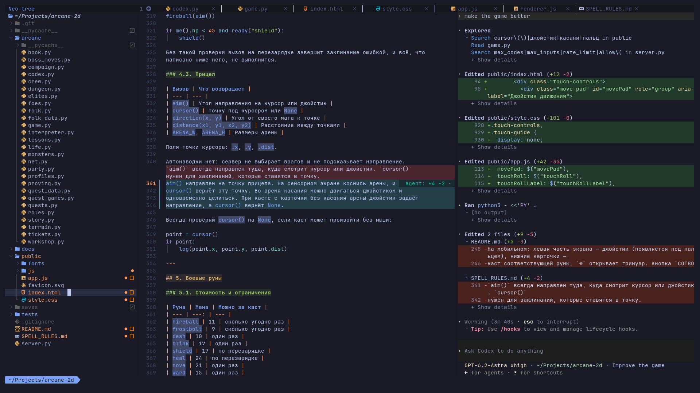
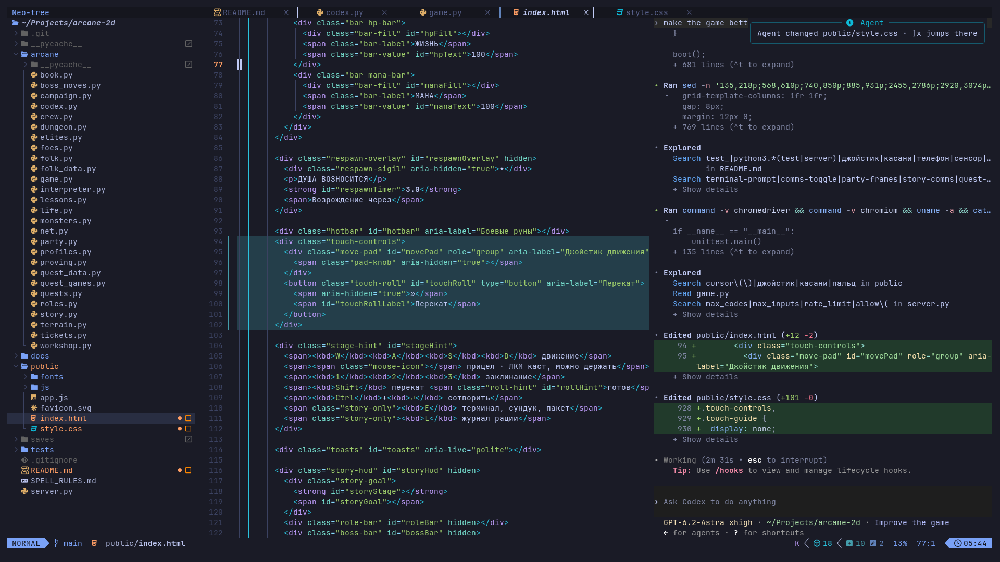
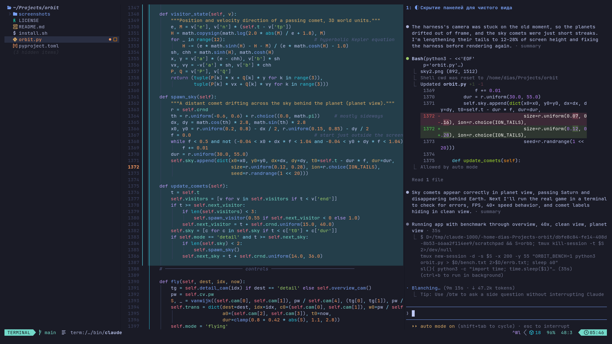

# lazyvim-agent

Панель ИИ-агента для [LazyVim](https://www.lazyvim.org) в стиле Cursor и
инструменты git, чтобы проверять, что агент сделал.

[English](README.md) · **Русский**


<sub>Codex переписывает абзац в панели справа, и та же правка видна слева прямо в коде: удалённые строки красным над новыми, у курсора размер правки.</sub>

По большей части это не новый плагин, а готовый проверенный набор
спецификаций [lazy.nvim](https://github.com/folke/lazy.nvim). Он связывает три
существующих плагина, даёт им клавиши, которые не конфликтуют друг с другом, и
добавляет один небольшой собственный модуль:

- **[claudecode.nvim](https://github.com/coder/claudecode.nvim)**: Claude Code
  в панели справа (40% ширины). Подключается к Neovim так же, как расширение
  для VS Code: знает текущий файл и выделение. Когда Claude спрашивает
  разрешение на правку, она показывается прямо в файле (удалённое красным,
  новое зелёным), и её можно принять или отклонить.
- **Правки вживую** (собственный модуль `lazyvim-agent.follow`): когда агент
  меняет файлы без вопроса (auto mode у Claude или любой другой агент), ты
  видишь это прямо в редакторе. Файл открывается слева на месте правки,
  изменения остаются подсвеченными, и каждое можно оставить или откатить, как
  Keep / Undo в Cursor.
- **[sidekick.nvim](https://github.com/folke/sidekick.nvim)**: любой другой
  агент, который у тебя установлен (Codex, OpenCode, Cursor Agent, Copilot CLI,
  Gemini, Aider и другие), в такой же панели. Есть меню готовых запросов:
  объяснить, исправить, проверить код, написать тесты, исправить ошибки.
- **[diffview.nvim](https://github.com/sindrets/diffview.nvim)**: все
  незакоммиченные изменения в одной вкладке, чтобы проверить работу агента до
  коммита. Ещё история файла и репозитория, подписи «кто менял строку» и
  подсветка для сообщений коммитов и списков rebase.

Всё это работает поверх того, что для git уже есть в LazyVim: lazygit,
gitsigns и пикеры Snacks.


<sub>Codex добавляет сенсорное управление: новый блок в index.html подсвечен в редакторе. style.css изменился, пока курсор был в редакторе, поэтому не открылся поверх, а пришло уведомление, куда перейти.</sub>

## Что нужно

- Neovim **0.11.2** или новее (этого требует sidekick.nvim)
- LazyVim (спецификации используют Snacks и группы which-key из LazyVim)
- [Claude Code](https://docs.anthropic.com/en/docs/claude-code) (`claude`)
  для основной панели; другие агенты по желанию
- `git`; [lazygit](https://github.com/jesseduffield/lazygit) для `<leader>gg`

API-ключи не нужны: каждый агент работает через свой логин или подписку.

## Установка

Создай файл `~/.config/nvim/lua/plugins/agent.lua`:

```lua
return {
  { "dszhlt/lazyvim-agent", import = "lazyvim-agent.plugins" },
}
```

Перезапусти Neovim, lazy.nvim сам всё установит при первом запуске.

Если нужна только одна часть, подключи один файл:

```lua
{ "dszhlt/lazyvim-agent", import = "lazyvim-agent.plugins.ai" },  -- только агенты
{ "dszhlt/lazyvim-agent", import = "lazyvim-agent.plugins.git" }, -- только git
```

> **Важно:** не включай одновременно extra LazyVim `ai.sidekick`: его клавиши
> `<leader>aa`, `<leader>as`, `<leader>ad` и `<leader>af` пересекаются с
> клавишами агентов отсюда. Extra `ai.claudecode` включать можно: клавиши отсюда
> заменяют его клавиши.

## Как пользоваться

1. Открой проект и нажми `<leader>ac` (или набери `:ClaudeCode`). Справа
   откроется Claude. В новой папке он сначала спросит, доверяешь ли ты ей, и
   только потом подключится к Neovim. Другого агента запускает `<leader>ao`.
2. Выдели код и нажми `<leader>as`. Он уйдёт тому агенту, с которым ты работаешь
   (Claude или любому другому), и курсор перейдёт туда, чтобы написать, что с ним
   сделать. `<leader>aO` прячет и показывает агента, `<leader>aq` закрывает.
3. Когда Claude спрашивает разрешение на правку, она открывается прямо в
   файле: `<leader>aa` (или `:w`) принимает, `<leader>ad` отклоняет.
4. В auto mode или с другим агентом правки сразу попадают на диск. Каждый
   изменённый файл открывается слева на месте правки: удалённые строки красным,
   под ними подсвечены новые. Поставь курсор на правку и нажми `<leader>ay`, чтобы
   оставить её, или `<leader>an`, чтобы откатить. `]x` / `[x` переходят между
   всеми правками, в том числе в других файлах.
5. Нажми `<leader>gv`, чтобы посмотреть все изменения, и закоммить их через
   lazygit (`<leader>gg`).


<sub>Claude Code в auto mode: всё, что он написал в orbit.py с первой правки, остаётся подсвеченным, пока ты не оставишь или не откатишь это.</sub>

Чтобы вернуться к прошлой работе, нажми `<leader>ar` (или набери
`:AgentSessions`). Откроется список сессий, которые Claude Code, Codex и OpenCode
сохранили для текущей папки: сначала самые свежие, с названием или первым
запросом. Выбранная сессия открывается там же, где обычно работает этот агент:
Claude через claudecode (связь с Neovim сохраняется), Codex и OpenCode в панели
sidekick. Если этот агент уже ведёт здесь сессию, сначала спросит, закрыть ли её.

`<C-h>` переводит из агента в код, `<C-l>` обратно. Чтобы прокрутить или
скопировать текст в окне агента, выйди из режима ввода через `<C-\><C-n>`,
а `i` вернёт к вводу.

## Клавиши

### Агенты

Запустить:

| Клавиши | Что делает |
|---|---|
| `<leader>ac` | открыть или спрятать Claude Code |
| `<leader>ao` | выбрать другого установленного агента (Codex, OpenCode, …) или запущенную сессию |

Эти клавиши работают с **текущим агентом, каким бы он ни был**: с тем, в окне
которого ты сейчас, а если ты в коде, то с последним, которым пользовался.

| Клавиши | Что делает |
|---|---|
| `<leader>af` | перейти в окно агента |
| `<leader>aO` | показать или спрятать окно агента |
| `<leader>ah` | спрятать все окна агентов (агенты продолжают работать) |
| `<leader>aq` | закрыть агента (остановить); если запущено несколько и ты не в окне одного из них, спросит какого |
| `<leader>aQ` | закрыть всех агентов |
| `<leader>ab` / `<leader>aF` | добавить текущий файл |
| `<leader>as` / `<leader>av` | отправить выделенное (в visual) / добавить файл под курсором (в дереве файлов) |
| `<leader>ap` | меню запросов: объяснить, исправить, проверить, тесты, ошибки |
| `<leader>am` | сменить модель (окно выбора у Claude; `/model` в Codex, `/models` в OpenCode) |
| `<leader>ar` | выбрать сохранённую сессию любого агента в этой папке и продолжить её (см. выше) |
| `<leader>aC` | продолжить самую свежую сессию в этой папке, какого бы агента она ни была |
| `<leader>aa` | принять: правку Claude, если ты в ней, иначе оставить правку агента под курсором |
| `<leader>ad` | отклонить: правку Claude, если ты в ней, иначе откатить правку агента под курсором |

### Правки вживую

| Клавиши | Что делает |
|---|---|
| `]x` / `[x` | следующая / предыдущая правка агента (дальше переходит в другой файл) |
| `<leader>ay` | оставить правку под курсором |
| `<leader>an` | откатить правку под курсором (файл сохраняется обратно) |
| `<leader>aY` / `<leader>aN` | оставить / откатить все правки в этом файле |
| `<leader>aA` | оставить все правки во всех файлах |
| `<leader>al` | список всех правок агента |
| `<leader>aw` | открывать ли каждый изменённый файл или только подсвечивать правки |
| `<leader>aW` | следить за проектом вручную, если агент запущен вне Neovim |

То же самое доступно командой `:AgentChanges list|next|prev|keep|undo|…`.

Как это работает: пока агент запущен в терминале Neovim, модуль следит за
папкой проекта (файлы из git и новые файлы, которые не в `.gitignore`). Если
файл изменился не из Neovim, он сравнивается с тем, каким был до первой правки
агента: с открытым буфером или с версией из индекса git. Файл, который не был
открыт и не лежит в git, считается новым, и при откате модуль предложит его
удалить. Если ты в этот момент пишешь код в окне редактора, файл агента не
открывается поверх, а приходит уведомление. Пока открыт lazygit или когда за
раз меняется больше 30 файлов (checkout, форматтер), буферы просто
перечитываются.

### Git

| Клавиши | Что делает |
|---|---|
| `<leader>gv` | Diffview: все незакоммиченные изменения (открыть/закрыть, `q` закрывает) |
| `<leader>gF` | Diffview: история этого файла или выделенных строк |
| `<leader>gV` | Diffview: история репозитория |
| `<leader>gt` | показывать или скрыть, кто менял строку |

В самом LazyVim уже есть `<leader>gg` lazygit, `<leader>gs` статус,
`<leader>gd` diff, `<leader>gl` лог, `]h` / `[h` переход между изменёнными
блоками и `<leader>ghs` / `<leader>ghr` / `<leader>ghp`, чтобы застейджить,
откатить или посмотреть блок.

## Настройка

Добавь спецификацию того плагина, который хочешь поменять. Твои значения
всегда главнее здешних:

```lua
return {
  { "dszhlt/lazyvim-agent", import = "lazyvim-agent.plugins" },

  -- Claude слева, 35% ширины
  {
    "coder/claudecode.nvim",
    opts = { terminal = { split_side = "left", split_width_percentage = 0.35 } },
  },

  -- другие агенты в плавающем окне
  { "folke/sidekick.nvim", opts = { cli = { win = { layout = "float" } } } },

  -- правки вживую: подсвечивать, но не открывать изменённые файлы
  { "lazyvim-agent", opts = { follow = false } },
}
```

Параметры правок вживую и их значения по умолчанию описаны в начале
[`lua/lazyvim-agent/follow.lua`](lua/lazyvim-agent/follow.lua): `watch`,
`follow`, список команд агентов `agents`, `pause_for`, `max_batch`,
`max_file_size` и `max_dirs`. Цвета задаются группами подсветки
`LazyVimAgentAdd`, `LazyVimAgentDelete` и `LazyVimAgentHint`; по умолчанию они
берут цвета diff из твоей темы.

Все параметры описаны в README самих плагинов:
[claudecode.nvim](https://github.com/coder/claudecode.nvim#advanced-configuration),
[sidekick.nvim](https://github.com/folke/sidekick.nvim#%EF%B8%8F-configuration),
[diffview.nvim](https://github.com/sindrets/diffview.nvim#configuration).

## Благодарности

Почти вся настоящая работа сделана в
[coder/claudecode.nvim](https://github.com/coder/claudecode.nvim),
[folke/sidekick.nvim](https://github.com/folke/sidekick.nvim),
[sindrets/diffview.nvim](https://github.com/sindrets/diffview.nvim),
[LazyVim](https://github.com/LazyVim/LazyVim) и его настройке git. Этот
репозиторий настраивает их на совместную работу и добавляет показ правок
вживую.

## Лицензия

[MIT](LICENSE)
